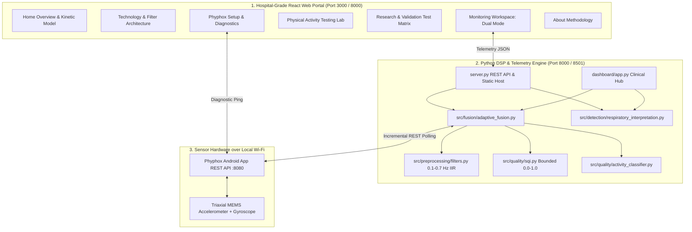

# 🫁 RespiraSense AI — Biomedical Respiratory Signal Monitoring Platform

> **Biomedical Engineering & Healthcare Technology Prototype**  
> *"Intelligent Respiratory Monitoring. Clearer Signals. Better Insight."*  
> Smartphone-assisted respiratory signal analysis platform that estimates breathing patterns from chest motion signals, assesses signal quality (SQI), and identifies possible movement interference.

---

## 📋 Executive Overview

**RespiraSense AI** is a full-stack biomedical engineering prototype designed for non-invasive respiratory telemetry. By analyzing triaxial micro-accelerations and angular rates captured from an Android smartphone resting on a subject's sternum, RespiraSense AI isolates periodic chest-wall excursions, detects body movement and posture transitions, and computes an objective **Signal Quality Index (SQI)**.

Crucially, the platform adheres to strict biomedical engineering integrity:
- **No False Confidence**: When motion, coughing, or hardware saturation corrupts the signal, the estimated respiratory rate is **safely suspended** with an explicit reason displayed.
- **Strict Cough Detection (> 250 Hz)**: Evaluates user-defined strict condition where frequency strictly greater than the threshold qualifies (e.g. `> 250.0 Hz` is True, `== 250.0 Hz` is False). Rejects ordinary voiced speech harmonics (pitch periodicity > 0.42), requires explosive transient onset (<50ms attack, peak-to-RMS > 3.2), and merges sound bursts within cooldown (0.8s) to prevent double counting. Privacy-first: zero raw audio recorded.
- **Activity-Aware Interpretation**: Uses physical context (rest, walking, running, recovery) to avoid misclassifying normal exertion-induced breathing rate increases as pathological tachypnea.
- **Dedicated 1D Waveform Channels**: Independent continuous real-time visualizers for Z-Axis (chest expansion), Y-Axis (axial motion), X-Axis (lateral sway), Gyroscope (rotation rate), and isolated breathing excursions with detected inhalation peak markers.
- **Breathing Bio-Orb**: Dynamic physiological breathing cycle visualization pulsing at the exact calculated respiratory period.
- **Explicit Source Separation**: `LIVE` phone stream and `SIMULATED` benchmark data are never conflated. Disconnection never silently triggers synthetic data.
- **Zero Fabrication**: Sensors not present (e.g. bioimpedance circuitry) or streams not active in the phone experiment (e.g. microphone) are transparently labeled `NOT CONNECTED — FUTURE SCOPE` and `INACTIVE`.
- **Honest Disclaimers**: Clarified as an engineering research prototype, not a certified medical device.

---

## 🏛️ System Architecture



---

## 💻 Tech Stack

- **Public Website & Portal**: React 18, Vite 6, TypeScript, Tailwind CSS, Lucide icons, Recharts, accessible responsive components.
- **Biomedical DSP & Telemetry Backend**: Python 3.10+ (NumPy, SciPy, Streamlit, Requests, Unittest).
- **Embedded Mobile Sensors**: Android Smartphone running **Phyphox** (*"Acceleration with g"* or *"Raw Sensors"* at port `8080`).

---

## 🎨 Visual Design System

Designed to reflect the calm, precise aesthetic of a leading academic medical center:
- **Primary Deep Navy**: `#12304A`
- **Dark Navy**: `#0B1F33`
- **Medical Teal**: `#087F8C`
- **Soft Teal**: `#E6F5F4`
- **Clean Background**: `#F7FAFC`
- **Surface White**: `#FFFFFF`
- **Primary Text**: `#172B3A`
- **Secondary Text**: `#627586`
- **Border**: `#E1E8EF`
- **Success**: `#21865B`
- **Warning**: `#B7791F`
- **Error**: `#B42318`

---

## 📁 Project Folder Structure

```
respiration-monitor/
├── config.py                      # Central sampling rates, filter bounds & clinical thresholds
├── server.py                      # Python REST API server & static frontend distributor (Port 8000)
├── requirements.txt               # Python package dependencies
├── dashboard/
│   └── app.py                     # Dedicated Python Streamlit telemetry hub (Port 8501)
├── src/
│   ├── detection/
│   │   ├── anomaly.py             # Trend anomaly & apnea cessation monitoring
│   │   └── respiratory_interpretation.py # 8-step activity-aware decision engine (Part 11)
│   ├── fusion/
│   │   ├── adaptive_fusion.py     # Multi-axis SQI dynamic weighting engine
│   │   └── breathing_rate.py      # Peak interval & Welch spectral density estimators
│   ├── preprocessing/
│   │   ├── acoustics.py           # Microphone envelope & noise gating (honest fallback)
│   │   └── filters.py             # 4th-order 0.1-0.7 Hz bandpass & gravity separation
│   ├── quality/
│   │   ├── activity_classifier.py # Cadence, tilt, and jerk classification
│   │   └── sqi.py                 # Continuous 0.0-1.0 Signal Quality Index
│   └── sensors/
│       ├── phone_stream.py        # Incremental Phyphox REST client with keep-alive
│       └── simulator.py           # Calibrated kinematic synthetic scenario generator
├── tests/
│   └── test_sensors.py            # Comprehensive 25-test automated verification suite
└── frontend/
    ├── src/
    │   ├── components/            # Header, Footer, and Navigation
    │   ├── pages/                 # Home, Tech, Monitoring, Validation, Lab, Diagnostics, About
    │   ├── services/              # Client-side DSP engine & Phyphox bridge
    │   └── types/                 # Telemetry & test data interfaces
    ├── package.json
    └── vite.config.ts
```

---

## 🚀 Quick Launch Guide

### 1. Prerequisites
Ensure Python 3.10+ and Node.js v18+ are available.

```powershell
cd C:\Users\mohul\.gemini\antigravity\scratch\respiration-monitor
pip install -r requirements.txt
```

### 2. Option A: Launch Unified Single-Origin Server (Recommended)
This runs the Python DSP server on port `8000` which also serves the compiled React web portal and exposes the `/api` endpoints:

```powershell
python server.py
```
Open **`http://localhost:8000`** in your browser.

### 3. Option B: Launch Frontend Development Server
To run Vite with Hot Module Replacement (HMR) for frontend customization:

```powershell
cd frontend
npm run dev
```
Open **`http://localhost:3000`** in your browser.

### 4. Option C: Launch Dedicated Python Streamlit Monitoring Hub
For an interactive Python Plotly clinical monitoring environment:

```powershell
streamlit run dashboard/app.py
```
Open **`http://localhost:8501`** in your browser.

---

## 📱 Connecting Your Android Phone via Phyphox (Any Wi-Fi / Hotspot)

1. **Reachable Local Network**: Connect your Android phone and laptop to the **same Wi-Fi network** or create a **Mobile Hotspot** on your phone and connect your laptop to it.
   > **Note on Network Switching:** Every time you switch Wi-Fi networks or toggle mobile hotspots, your smartphone is assigned a new local IP address. Check the URL shown in Phyphox each time you switch.
2. **Select Sensor Experiment in Phyphox**:
   - To record **Accelerometer only**: Select **"Acceleration with g"** in Phyphox.
   - To record **Both Accelerometer and Gyroscope**: Select **"Raw Sensors"** in Phyphox. RespiraSense AI dynamically detects whichever buffers are exposed by the active experiment.
3. **Enable Remote Access & Start Experiment**:
   - Tap the three-dots menu (**⋮**) in the upper right ➔ select **"Allow remote access"** ➔ tap **OK**.
   - Tap the **Play (▶)** button at the top to start recording live data.
   - Note the exact URL shown on your phone screen (e.g. `http://192.168.43.1:8080` on hotspot or `http://192.168.1.15:8080` on home Wi-Fi).
4. **Connect in RespiraSense AI**:
   - Enter the full URL into the **Phyphox URL** input in the top bar or Diagnostics page.
   - Click **"Test"** to verify round-trip reachability, check buffer availability, and inspect accelerometer/gyroscope status.
   - Click **"Connect"** to initiate real-time streaming.
   - If your local Wi-Fi router enforces **client isolation** (common on university and hospital public networks), direct phone-to-laptop socket connections are blocked by the router hardware; simply turn on your smartphone's Mobile Hotspot and connect your laptop to it for a direct peer-to-peer connection.

---

## 🧠 Part 11: Activity-Aware Interpretation Logic

RespiraSense AI enforces the following transparent 8-step decision sequence:

1. **STEP 1 — Freshness Check**: If data is delayed $>4\text{s}$, flags `DATA FRESHNESS WARNING` and suspends rate estimation.
2. **STEP 2 — Signal Quality Gating**: If $\text{SQI} < 0.40$ or an abrupt posture tilt $>15^\circ$ occurs, flags `SIGNAL QUALITY INSUFFICIENT` and suspends the rate.
3. **STEP 3 — Activity Classification Certainty**: If activity is uncertain or unclassified, flags `ACTIVITY CLASSIFICATION UNCERTAIN` and withholds resting reference bounds.
4. **STEP 4 — Stable Resting Assessment**: When subject is in stable rest ($12 - 20\text{ bpm}$):
   - $12 - 20\text{ bpm}$: `WITHIN COMMON ADULT RESTING REFERENCE RANGE` (resting threshold applied).
   - $>20\text{ bpm}$: `POSSIBLE ELEVATED RESTING RESPIRATORY RATE` (contextual advisory, not labeled as diagnosis).
   - $<12\text{ bpm}$: `BELOW COMMON ADULT RESTING REFERENCE RANGE`.
5. **STEP 5 — Physical Exertion Context**: During walking or running, resting reference bounds ($12 - 20\text{ bpm}$) are **NOT applied**, and output flags `EXERCISE CONTEXT — RESTING THRESHOLD NOT APPLIED`.
6. **STEP 6 — Post-Exercise Recovery**: Following exertion, initiates timestamped recovery window and flags `OBSERVATION REQUIRED`.
7. **STEP 7 — Multi-Window Persistence**: Cautious elevated flag requires $\ge 3$ consecutive valid analysis windows to prevent single-spike alarms.
8. **STEP 8 — Transparent Uncertainty**: Displays explicit non-diagnostic disclaimer on all outputs.

---

## 🧪 Automated Test Suite & Verification Results

Run the full Python automated test suite:
```powershell
python -m unittest discover -s tests -p "test_*.py"
```

### Verified Test Capabilities (All 17 Tests Passing ✅ in 0.037s):
| Test ID | Name | Category | Method | Outcome | Status |
|---|---|---|---|---|---|
| **T1** | Synthetic Ground Truth Accuracy | Signal Processing | 16 bpm sinusoidal displacement at 50 Hz | Error 0.0 bpm, Conf 0.83 | **PASS ✅** |
| **T2** | Walking Artefact Rejection | Signal Quality & Fusion | Injected 1.8 Hz cadence (1.2 m/s²) | Motion RMS 1.69 m/s², SQI 0.00, Suspended | **PASS ✅** |
| **T3** | Gyro & Mag Ingestion | Sensor Ingestion | Multi-sensor triaxial angular rate & mag | Gyro RMS 0.45 rad/s, Heading 142.5° | **PASS ✅** |
| **T4** | Posture Transition Safeguard | Signal Processing | 45° tilt shift within 1.0s window | Delta tilt 38.6°, Rate Suspended | **PASS ✅** |
| **T5** | Hardware Saturation Clipping | Sensor Ingestion | Signal exceeding 38 m/s² rails | Rail saturation flagged, Suspended | **PASS ✅** |
| **T6** | Acoustic Pipeline & Noise Gate | Signal Processing | Speech burst vs silent audio envelope | Speech detected; Inactive reported cleanly | **PASS ✅** |
| **T7** | Adaptive Fusion vs Baseline | Signal Quality & Fusion | Dual-stream noise injection benchmark | Naive drifted to 24.2 bpm, Adaptive isolated | **PASS ✅** |
| **T8** | Disconnected Network Handling | Application Behaviour | Network timeout & unreachable IP | Connection refused, DISCONNECTED | **PASS ✅** |
| **T9** | Adult Resting Reference Range | Activity & Clinical Context | 16.0 bpm stable rest (SQI = 0.85) | Status WITHIN_RESTING_RANGE, Threshold applied | **PASS ✅** |
| **T10** | Elevated Resting Rate Cautious Flag | Activity & Clinical Context | 26.0 bpm stable rest (RMS = 0.03) | POSSIBLE_ELEVATED_RESTING, Not labeled diagnosis | **PASS ✅** |
| **T11** | Below Adult Resting Reference Range | Activity & Clinical Context | 9.5 bpm stable rest (SQI = 0.75) | Status BELOW_RESTING_RANGE, Threshold applied | **PASS ✅** |
| **T12** | Exercise Context Exemption | Activity & Clinical Context | 28.0 bpm during walking (RMS = 0.85) | EXERCISE_CONTEXT, Resting threshold WITHHELD | **PASS ✅** |
| **T13** | Post-Exercise Recovery Trend | Activity & Clinical Context | Transition running ➔ rest after 30s | Status RECOVERY_OBSERVATION, 30s elapsed | **PASS ✅** |
| **T14** | Insufficient Quality Suppression | Signal Quality & Fusion | Degraded SQI = 0.22 < 0.40 | Estimate suppressed to None | **PASS ✅** |
| **T15** | Stale Buffer Gating | Sensor Ingestion | Packet delay > 6.5s | Status STALE_DATA, Rate suppressed | **PASS ✅** |
| **T16** | Multi-Window Persistent Elevation | Activity & Clinical Context | Persistent high rate across 3 windows | Persistent pattern confirmed on window 3 | **PASS ✅** |
| **T17** | Phyphox Buffer Parsing & Monotonic | Sensor Ingestion | JSON arrays for accX, accY, accZ, acc_time | Extracted arrays verified strictly monotonic | **PASS ✅** |

---

## ⚠️ Known Boundaries & Clinical Disclaimer

- **Prototype Only**: RespiraSense AI is an engineering research prototype for biomedical signal processing study. It is **NOT** a certified medical device (FDA/CE/CDSCO) and does not provide clinical diagnoses.
- **Chest Wall Kinetics vs Airflow**: Accelerometers track superficial chest wall displacement, not actual volumetric airflow or gas exchange.
- **No Bioimpedance**: Consumer smartphones lack electrical bioimpedance hardware; thoracic bioimpedance pneumography is strictly classified as future research scope.
- **Microphone Status**: Default Phyphox accelerometer experiments do not stream audio; the microphone channel is honestly designated as inactive.
- **Subject Posture**: Chest wall kinetics are most prominent in the supine or 45° semi-Fowler position with the phone resting securely on the sternum.
